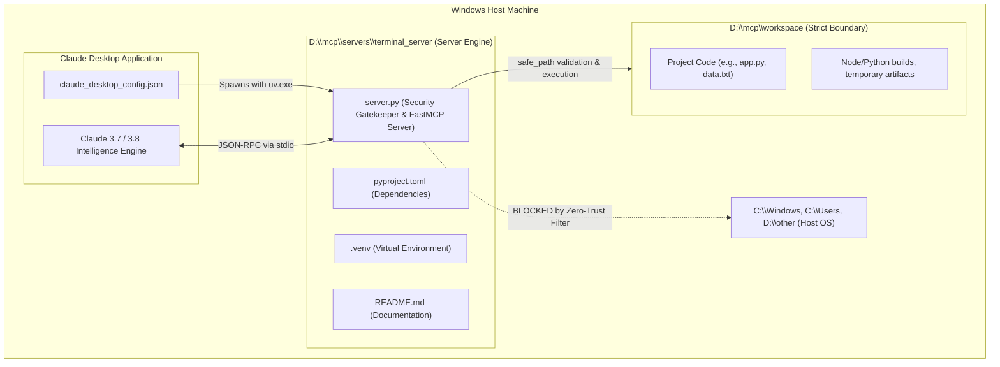

# 🛡️ Workspace Manager MCP Server

[](https://www.python.org/)
[](https://modelcontextprotocol.io/)
[](https://github.com/modelcontextprotocol/python-sdk)
[](#zero-trust-security-how-it-protects-the-pc)
[](https://microsoft.com/windows)

**Workspace Manager MCP Server** is a secure, production-grade Model Context Protocol (MCP) server that empowers **Claude Desktop** to autonomously read, write, and execute terminal commands while enforcing **strict Zero-Trust isolation**. All file operations and command executions are mathematically quarantined inside `D:\mcp\workspace` on Windows, ensuring that an AI assistant cannot access, alter, or damage anything on the host computer.

---

## 🔌 What is MCP? (Explain Like I'm 5)

Imagine buying a state-of-the-art laptop, but it has **no ports**—no USB, no HDMI, no SD card slot. Even if it's the fastest computer in the world, it cannot print a document, read a flash drive, or control an external mouse.

Until recently, Large Language Models (LLMs) like Claude were like that portless laptop: brilliant at thinking and conversing, but isolated in a digital bubble without direct access to your local files, compilers, or developer tools.

> **The Model Context Protocol (MCP) is the universal USB-C port for Artificial Intelligence.**

Just like USB-C allows you to plug any external device into your laptop using one standard cable, MCP allows AI applications to connect to external databases, filesystems, and terminal servers using an open standard protocol.

```
       +-------------------------------------------------------------+
       |                        Claude Desktop                       |
       |                    (The Host / Client AI)                   |
       +-------------------------------------------------------------+
                                      │
                         JSON-RPC messages via stdin/stdout
                                (The USB-C Cable)
                                      │
                                      ▼
       +-------------------------------------------------------------+
       |               server.py ("WorkspaceManager")                |
       |                      (The MCP Server)                       |
       +-------------------------------------------------------------+
                                      │
                         Sandboxed Tools & Verification
                                      │
                                      ▼
                      +───────────────────────────────+
                      |        D:\mcp\workspace       |
                      |   (Secure Local Environment)  |
                      +───────────────────────────────+
```

### The Three Roles in MCP:
1. **The Host / Client (Claude Desktop)**: The brains of the operation. It decides *when* and *why* an external tool is required.
2. **The Server (`server.py`)**: The security guard and translator. It advertises available tools, intercepts AI requests, validates security boundaries, and carries out operations.
3. **The Tools (`list_workspace`, `read_file`, `write_file`, `execute_command`)**: Individual Python functions exposed to the AI that act as hands and eyes in the local operating system.

### How They Talk (`stdio` & JSON-RPC)
Claude Desktop launches `server.py` as a background child process. They communicate by passing structured **JSON-RPC** packets over the server process's standard input (`stdin`) and standard output (`stdout`).

---

## 🏛️ Project Architecture & Folder Structure

This project strictly separates the **server execution code** from the **sandboxed workspace**:



### Directory Layout
```text
D:\mcp\
├── servers\
│   └── terminal_server\          <-- SERVER CODE (DO NOT ALLOW CLAUDE TO EDIT)
│       ├── .venv\                <-- Isolated Python 3.13 dependencies
│       ├── .python-version       <-- Python version declaration (3.13)
│       ├── pyproject.toml        <-- uv project configuration (mcp[cli])
│       ├── uv.lock               <-- Locked reproducible dependencies
│       ├── README.md             <-- Architecture & beginner setup guide
│       └── server.py             <-- Zero-Trust Hardened MCP Server implementation
│
└── workspace\                    <-- THE SANDBOX (CLAUDE'S WORKSPACE)
    ├── app.py                    <-- Files created and edited by Claude
    └── ...                       <-- All CLI commands strictly execute here
```

---

## 🔒 Zero-Trust Security: How It Protects the PC

Giving an AI assistant terminal access to a computer sounds terrifying—what if it hallucinates, executes a prompt injection payload, or runs `del C:\Windows`?

This server implements **Zero-Trust Hardened Security**. It assumes every tool call is potentially malicious and applies defense-in-depth before executing anything.

### 1. Hardened Path Sandboxing (`safe_path`)
Whenever Claude attempts to access a file, `safe_path()` resolves the canonical destination and verifies that it is strictly inside `D:\mcp\workspace`:

```python
def safe_path(target: str) -> Path:
    # 1. Immediately block UNC network shares (\\server\share)
    if target.startswith(("\\\\", "//")):
        raise ValueError(r"Security Violation: Access denied. Path is outside D:\mcp\workspace.")

    # 2. Fully resolve the path, neutralizing relative hops and symlinks
    resolved = (WORKSPACE_DIR / target).resolve()

    # 3. Mathematically assert that the path is a child of the workspace
    if not resolved.is_relative_to(WORKSPACE_DIR):
        raise ValueError(r"Security Violation: Access denied. Path is outside D:\mcp\workspace.")

    return resolved
```
* **Why it matters**: Even if Claude passes tricky combinations like `sub/../../secret.txt`, `.resolve()` turns it into `D:\mcp\secret.txt`. Because that path is outside `D:\mcp\workspace`, `is_relative_to()` evaluates to `False`, and access is immediately denied.
* **Symlink / Junction Neutralization**: Windows directory junctions and NTFS symlinks are resolved to their true physical targets on disk before permission is granted.

### 2. Forbidding Drive Letters in CLI Commands
Any command string matching the regex `[a-zA-Z]:` is instantly rejected before reaching the shell.
* **Blocked**: `type C:\Windows\win.ini`
* **Blocked**: `dir c:`
* **Blocked**: `D:\other\script.bat`
* **Why it matters**: Claude cannot inspect or manipulate files on your `C:` drive or other directories on `D:`.

### 3. Forbidding Directory Traversal (`..`) in Commands
Any occurrence of `..` anywhere in the command is rejected.
* **Blocked**: `type ..\secret.txt`
* **Blocked**: `cd ..`
* **Why it matters**: Prevents escaping the working directory via relative parent hops.

### 4. Forbidding Environment Variable Expansion
Commands containing `%...%` (Windows Command Prompt) or `$env:` (PowerShell) are rejected.
* **Blocked**: `echo %SYSTEMROOT%`
* **Blocked**: `type %USERPROFILE%\Desktop\passwords.txt`
* **Blocked**: `echo $env:PATH`
* **Why it matters**: Attackers cannot use Windows system variables to locate sensitive folders.

### 5. Destructive Binary Blacklist
Even within the workspace, critical administrative and destructive utilities are blocked using word-boundary pattern matching:
* **Blacklisted Binaries**: `format`, `diskpart`, `shutdown`, `reg`, `net user`, `takeown`, `icacls`, `bcdedit`, `vssadmin`.

### 6. The "Stdout Purity" Rule (No `print()`)
> [!IMPORTANT]
> In an MCP stdio server, `sys.stdout` belongs exclusively to the JSON-RPC wire protocol.

If your code runs `print("Server started")`, that human text gets injected into the JSON stream. Claude Desktop's JSON parser will fail with a syntax error, causing the entire connection to crash with the dreaded *"Server disconnected"* error.

**Our Rule**: All diagnostic logging is strictly routed to `sys.stderr` via Python's standard `logging` module:
```python
logging.basicConfig(
    level=logging.INFO,
    format="%(asctime)s - %(name)s - %(levelname)s - %(message)s",
    stream=sys.stderr,  # Keeps stdout 100% clean for JSON-RPC
)
```

### 7. Denial-of-Service & Resource Exhaustion Protection
* **Output Truncation**: CLI output is capped at `50,000` characters. If a command runs `pip list` or dumps a gigantic binary file, output is cleanly truncated with an explanatory warning, preventing memory exhaustion in Claude Desktop.
* **Strict Timeout**: All commands have a hard `30-second` timeout to terminate infinite loops or hung processes.

---

## 🛠️ Step-by-Step Installation & Setup (Windows)

### Prerequisites
* **Operating System**: Windows 10 or Windows 11
* **Python**: Python 3.13 or newer ([Download from python.org](https://www.python.org/downloads/))
* **uv Package Manager**: Fast Python package manager ([Install guide](https://docs.astral.sh/uv/getting-started/installation/))
* **Claude Desktop**: Official Anthropic Claude Desktop client for Windows

---

### Step 1: Create Directories
Open PowerShell and create both the server project folder and the workspace sandbox:
```powershell
New-Item -ItemType Directory -Force -Path "D:\mcp\workspace"
New-Item -ItemType Directory -Force -Path "D:\mcp\servers\terminal_server"
```

---

### Step 2: Initialize Project with `uv`
Navigate to the server directory and set up the Python environment:
```powershell
Set-Location "D:\mcp\servers\terminal_server"
uv init
uv add "mcp[cli]"
```

> [!NOTE]
> `uv` creates a lightning-fast virtual environment in `.venv` with `mcp` and its dependencies pre-installed.

---

### Step 3: Find Full Path to `uv.exe`
Claude Desktop needs the absolute path to your `uv.exe` executable. Run:
```powershell
where.exe uv
```
Typical output on Windows:
```text
C:\Users\<YourUsername>\AppData\Local\Programs\Python\Python313\Scripts\uv.exe
```
*(Copy this path for the configuration step below).*

---

## 🖥️ Claude Desktop Configuration

Claude Desktop reads local MCP servers from a configuration file named `claude_desktop_config.json`.

### Where the Configuration File Lives on Windows:
Depending on how Claude Desktop was installed, its config file is located at:
* **Standard Installer Path**:
  `%APPDATA%\Claude\claude_desktop_config.json`
  *(i.e. `C:\Users\<YourUsername>\AppData\Roaming\Claude\claude_desktop_config.json`)*
* **Windows Store / MSIX Packaged Path**:
  `C:\Users\<YourUsername>\AppData\Local\Packages\Claude_pzs8sxrjxfjjc\LocalCache\Roaming\Claude\claude_desktop_config.json`

> [!TIP]
> You can open this file directly from inside Claude Desktop by going to:
> **Settings (`Ctrl+,`) → Developer → Edit Config**.

### The Exact JSON Configuration:
Open your `claude_desktop_config.json` and add the `workspace-manager` entry under `mcpServers`. Make sure to **double-escape backslashes** (`\\`) in Windows paths:

```json
{
  "mcpServers": {
    "workspace-manager": {
      "command": "C:\\Users\\<YourUsername>\\AppData\\Local\\Programs\\Python\\Python313\\Scripts\\uv.exe",
      "args": [
        "--directory",
        "D:\\mcp\\servers\\terminal_server",
        "run",
        "server.py"
      ]
    }
  }
}
```

> [!CAUTION]
> **Always Restart Claude Desktop!**
> Claude Desktop only spawns MCP server processes when the application starts up. Whenever you modify `server.py` or edit `claude_desktop_config.json`, fully close Claude Desktop (check the Windows System Tray / Task Manager) and launch it again.

---

## 🧪 Experiments We Performed & Results (The Proof)

To verify the Zero-Trust security model, we ran red-team and functional tests against the running server. Here are the real results:

### Test 1: Drive Escape Attack
* **Scenario**: Attempting to read a sensitive Windows OS file on `C:` drive via terminal command.
* **Command Submitted**: `type C:\Windows\win.ini`
* **Server Interception**:
  ```text
  Security Violation: Access denied. Drive letters (e.g. 'C:', 'D:') are forbidden in commands.
  ```
* **Status**: ✅ **BLOCKED**

---

### Test 2: Directory Traversal Escape Attack
* **Scenario**: Attempting to hop backward out of the workspace sandbox to read secret files.
* **Tool Call**: `read_file("../../secret.txt")`
* **Server Interception**:
  ```text
  Security Violation: Access denied. Path is outside D:\mcp\workspace.
  ```
* **Status**: ✅ **BLOCKED**

---

### Test 3: Environment Variable Reconnaissance
* **Scenario**: Attempting to expand `%SYSTEMROOT%` or `$env:USERPROFILE` to locate user files.
* **Command Submitted**: `echo %SYSTEMROOT%`
* **Server Interception**:
  ```text
  Security Violation: Access denied. Environment variable expansion ('%...%') is forbidden.
  ```
* **Status**: ✅ **BLOCKED**

---

### Test 4: Destructive Binary Attack
* **Scenario**: Attempting to invoke dangerous administrative utilities.
* **Commands Tested**: `format D:`, `shutdown /r /t 0`, `diskpart`, `net user hacker /add`
* **Server Interception**:
  ```text
  Security Violation: Access denied. Destructive system command is blacklisted.
  ```
* **Status**: ✅ **BLOCKED**

---

### Test 5: Legitimate Workspace Operations
* **Scenario**: Asking Claude to create a Python script `app.py` in `D:\mcp\workspace`, list the folder, and run it.
* **Actions Performed**:
  1. `write_file("app.py", "print('Hello from Workspace Sandbox!')")`
  2. `list_workspace(".")` -> Confirmed `app.py` is present (`38` bytes).
  3. `execute_command("python app.py")` -> Returned:
     ```json
     {
       "stdout": "Hello from Workspace Sandbox!\n",
       "stderr": "",
       "exit_code": 0
     }
     ```
* **Status**: ✅ **PASSED (100% Functionality Preserved)**

---

### Test 6: Human-in-the-Loop Safeguard
Before Claude Desktop executes any tool (`write_file`, `execute_command`), Claude presents an interactive prompt to the human user displaying the exact tool arguments:

```
[Claude wants to call WorkspaceManager: execute_command]
command: "python app.py"
[Allow Once]  [Allow Always for This Chat]  [Reject]
```
Even if an adversarial prompt injection attacks Claude's reasoning, you retain final veto power over every execution.

---

## 🧰 Available Tools Reference

| Tool Name | Parameters | Return Type | Description |
| :--- | :--- | :--- | :--- |
| `list_workspace` | `subpath: str = "."` | `str` (JSON) | Lists files and directories with sizes and types inside the workspace. Rejects escaping paths. |
| `read_file` | `filepath: str` | `str` | Safely reads UTF-8 text files inside `D:\mcp\workspace`. Returns clean security message if boundary is breached. |
| `write_file` | `filepath: str`, `content: str` | `str` | Writes text files, creating parent directories safely within the workspace boundary. |
| `execute_command` | `command: str` | `str` (JSON) | Runs sanitized CLI commands with strict timeout (30s) and output capping (50K chars). Working directory locked to `D:\mcp\workspace`. |

---

## 🔧 Troubleshooting Guide (Windows Gotchas)

### 1. Hammer / Connector Icon Does Not Appear in Claude
* **Cause**: Claude Desktop failed to launch `uv.exe` or could not find `server.py`.
* **Fix**:
  1. Confirm `uv.exe` path exists using `Test-Path "C:\path\to\uv.exe"`.
  2. Check that all backslashes in `claude_desktop_config.json` are doubled (`\\`).
  3. Check Claude's diagnostic log files located at:
     `%APPDATA%\Claude\logs\mcp*.log`

### 2. Code Changes in `server.py` Are Not Taking Effect
* **Cause**: Claude Desktop keeps the server subprocess running for the duration of the app session.
* **Fix**: Completely exit Claude Desktop (Right-click tray icon → Quit, or kill via Task Manager) and restart.

### 3. "No module named 'mcp.server.fastmcp'" Error
* **Cause**: `mcp` 2.x renamed `FastMCP` to `MCPServer`.
* **Fix**: Our `server.py` includes backward and forward compatibility:
  ```python
  try:
      from mcp.server.fastmcp import FastMCP
  except (ImportError, ModuleNotFoundError):
      from mcp.server.mcpserver import MCPServer as FastMCP
  ```
  This handles both legacy v1 environments and the new v2 SDK automatically.

### 4. Accidental Command Rejections
* If you run a command like `python C:\script.py`, it will be blocked by design because of `C:`.
* **Fix**: Keep all assets and dependencies inside `D:\mcp\workspace` and use relative references (`python script.py`).

---

## 📄 License & Credits

Built with ❤️ using:
* [Model Context Protocol (MCP)](https://modelcontextprotocol.io/) by Anthropic
* [FastMCP Python SDK](https://github.com/modelcontextprotocol/python-sdk)
* [uv](https://github.com/astral-sh/uv) by Astral
