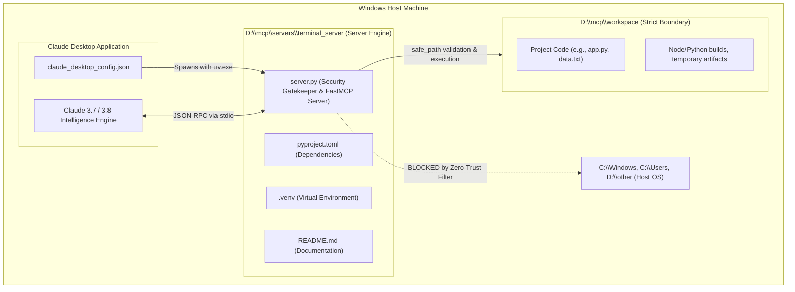

# 🛡️ Workspace Manager MCP Server

[](https://www.python.org/)
[](https://modelcontextprotocol.io/)
[](https://github.com/modelcontextprotocol/python-sdk)
[](#zero-trust-security-architecture)
[](https://microsoft.com/windows)

**Workspace Manager MCP Server** is a secure, production-grade Model Context Protocol (MCP) server that empowers **Claude Desktop** to autonomously read, write, and execute terminal commands while enforcing **strict Zero-Trust isolation**. All file operations and command executions are mathematically quarantined inside `D:\mcp\workspace` on Windows, ensuring that an AI assistant cannot access, alter, or damage anything on the host computer.

---

## Model Context Protocol (MCP) Architecture

The **Model Context Protocol (MCP)** is an open standard developed by Anthropic designed to connect AI assistants like Claude to external tools, local filesystems, databases, and APIs.

By default, Large Language Models operate in an isolated context without direct operating system access. MCP solves this by establishing a standardized client-server architecture:

```
       +-------------------------------------------------------------+
       |                        Claude Desktop                       |
       |                    (Host Application / AI)                  |
       +-------------------------------------------------------------+
                                      │
                         JSON-RPC 2.0 messages via stdio
                                      │
                                      ▼
       +-------------------------------------------------------------+
       |               server.py ("WorkspaceManager")                |
       |                      (Local MCP Server)                     |
       +-------------------------------------------------------------+
                                      │
                         Sandboxed Tools & Verification
                                      │
                                      ▼
                       +───────────────────────────────+
                       |        D:\mcp\workspace       |
                       |      (Allowed Target Path)    |
                       +───────────────────────────────+
```

### Architectural Roles:
1. **The Host / Client (Claude Desktop)**: The LLM runtime and user interface. It detects user intent, determines when external tools are required, constructs arguments, and formats the output.
2. **The Server (`server.py`)**: The local background process exposing tools over stdio. It acts as an authoritative security boundary by validating all incoming arguments before execution.
3. **The Tools (`list_workspace`, `read_file`, `write_file`, `execute_command`)**: Discrete Python functions registered via FastMCP that execute within the local environment.

### Transport and Protocol (`stdio` & JSON-RPC)
The host spawns `server.py` as a subprocess and establishes communication through standard input (`stdin`) and standard output (`stdout`). All messages adhere to the JSON-RPC 2.0 specification, enabling bi-directional tool invocation without opening network ports or exposing local sockets to the internet.

---

## Project Architecture and Directory Structure

This project strictly separates the **server execution code** from the **sandboxed workspace**:



### Directory Layout
```text
D:\mcp\
├── servers\
│   └── terminal_server\          <-- SERVER CODE (DO NOT ALLOW CLAUDE TO EDIT)
│       ├── .venv\                <-- Isolated Python 3.13 dependencies
│       ├── .python-version       <-- Python version declaration (3.13)
│       ├── pyproject.toml        <-- uv project configuration (mcp[cli])
│       ├── uv.lock               <-- Locked reproducible dependencies
│       ├── README.md             <-- Architecture & setup guide
│       └── server.py             <-- Zero-Trust Hardened MCP Server implementation
│
└── workspace\                    <-- THE SANDBOX (CLAUDE'S WORKSPACE)
    ├── app.py                    <-- Files created and edited by Claude
    └── ...                       <-- All CLI commands strictly execute here
```

---

## Practical Use Cases

This server transforms Claude Desktop from a passive text generator into an active, self-correcting development partner. Common workflows include:

### 1. Autonomous Development and Self-Healing Debug Loops
Instead of manually copying code snippets between Claude and an editor:
- Prompt Claude: *"Build a command-line currency converter in Python that fetches live exchange rates from an open API. Save it, run it, and verify the output."*
- Claude writes `converter.py` using `write_file`.
- Claude runs `python converter.py` using `execute_command`.
- If an exception or missing dependency occurs, Claude reads the traceback from `stderr`, updates the code via `write_file`, and re-runs the script until execution succeeds.

### 2. Local Data Engineering and Analytics
Place datasets (CSV, JSON, SQLite, Parquet) into `D:\mcp\workspace`:
- Prompt Claude: *"Analyze `quarterly_sales.csv`. Filter for the EMEA region, calculate average order value by product category, and generate a markdown summary report."*
- Claude inspects the folder with `list_workspace`, writes a script utilizing Pandas or DuckDB, executes the calculation, and returns the verified findings.

### 3. Automated Refactoring and Test Suite Execution
When modernizing legacy code or improving test coverage:
- Place your module and test files in `D:\mcp\workspace`.
- Prompt Claude: *"Run `pytest`. Analyze every failing test, refactor `parser.py` to fix the bugs without changing expected signatures, and confirm all tests pass."*
- Claude executes the test runner, isolates failures, refactors the source files, and verifies coverage.

### 4. Project Scaffolding and Environment Setup
- Have Claude bootstrap complete projects from scratch (e.g., `uv init`, `npm init -y`, `cargo init`).
- Claude can scaffold configuration files, package manifests, folder trees, and verify that the initial project builds cleanly.

### 5. Automated File Processing and Batch Conversions
- Batch file renaming, bulk JSON formatting, log file parsing, Markdown document generation, and media transformations using CLI tools (e.g., `ffmpeg`).
- Claude formulates the exact shell command, executes it within the sandbox, and validates output files.

### 6. Sandboxed Script Experimentation
- Evaluate third-party libraries, inspect unfamiliar code samples, or test experimental automation scripts inside an isolated directory without risking changes to host system files or environment variables.

---

## Zero-Trust Security Architecture

Executing shell commands and modifying filesystem contents at the request of an LLM introduces significant security risks, including prompt injection, model hallucinations, and accidental host modification.

This server implements a **Zero-Trust Hardened Security Model**. It treats every incoming tool call as potentially untrusted and applies multiple layers of validation before any action is executed.

### 1. Hardened Path Sandboxing (`safe_path`)
Whenever Claude attempts to access a file, `safe_path()` resolves the canonical destination and verifies that it is strictly inside `D:\mcp\workspace`:

```python
def safe_path(target: str) -> Path:
    # 1. Immediately block UNC network shares (\\server\share)
    if target.startswith(("\\\\", "//")):
        raise ValueError(r"Security Violation: Access denied. Path is outside D:\mcp\workspace.")

    # 2. Fully resolve the path, neutralizing relative hops and symlinks
    resolved = (WORKSPACE_DIR / target).resolve()

    # 3. Mathematically assert that the path is a child of the workspace
    if not resolved.is_relative_to(WORKSPACE_DIR):
        raise ValueError(r"Security Violation: Access denied. Path is outside D:\mcp\workspace.")

    return resolved
```
* **Mechanics**: Even if an LLM constructs complex relative paths like `sub/../../secret.txt`, `.resolve()` evaluates the canonical path to `D:\mcp\secret.txt`. Because that path is outside `D:\mcp\workspace`, `is_relative_to()` evaluates to `False`, and access is immediately denied.
* **Symlink and Junction Neutralization**: Windows directory junctions and NTFS symlinks are resolved to their true physical targets on disk before permission is granted.

### 2. Forbidding Drive Letters in CLI Commands
Any command string matching the regex `[a-zA-Z]:` is instantly rejected before reaching the shell.
* **Blocked**: `type C:\Windows\win.ini`
* **Blocked**: `dir c:`
* **Blocked**: `D:\other\script.bat`
* **Purpose**: Prevents the model from targeting host drives (`C:`) or directories outside the designated root on `D:`.

### 3. Forbidding Directory Traversal (`..`) in Commands
Any occurrence of `..` anywhere in the command is rejected.
* **Blocked**: `type ..\secret.txt`
* **Blocked**: `cd ..`
* **Purpose**: Prevents escaping the working directory via relative parent navigation.

### 4. Forbidding Environment Variable Expansion
Commands containing `%...%` (Windows Command Prompt) or `$env:` (PowerShell) are rejected.
* **Blocked**: `echo %SYSTEMROOT%`
* **Blocked**: `type %USERPROFILE%\Desktop\passwords.txt`
* **Blocked**: `echo $env:PATH`
* **Purpose**: Prevents resolving system environment variables to locate sensitive system directories or credentials.

### 5. Destructive Binary Blacklist
Even within the workspace, critical administrative and destructive utilities are blocked using word-boundary pattern matching:
* **Blacklisted Binaries**: `format`, `diskpart`, `shutdown`, `reg`, `net user`, `takeown`, `icacls`, `bcdedit`, `vssadmin`.

### 6. The "Stdout Purity" Rule (No `print()`)
> [!IMPORTANT]
> In an MCP stdio server, `sys.stdout` belongs exclusively to the JSON-RPC wire protocol.

If application code executes `print("Server started")`, that text is emitted into the standard output stream. Claude Desktop's JSON-RPC parser will encounter a deserialization failure, causing the connection to disconnect.

All diagnostic logging is strictly routed to `sys.stderr` via Python's standard `logging` module:
```python
logging.basicConfig(
    level=logging.INFO,
    format="%(asctime)s - %(name)s - %(levelname)s - %(message)s",
    stream=sys.stderr,  # Keeps stdout 100% clean for JSON-RPC
)
```

### 7. Denial-of-Service and Resource Exhaustion Protection
* **Output Truncation**: CLI output is capped at `50,000` characters. If a command attempts to dump a large binary or run an unbounded listing, output is cleanly truncated with an explanatory notice.
* **Strict Execution Timeout**: All commands enforce a hard `30-second` timeout to terminate infinite loops or hung processes.

---

## Setup on Any Machine

Follow these instructions to deploy this MCP server on any Windows computer (or adapt it for macOS/Linux).

### Prerequisites
1. **Python 3.13+**: Installed and available in PATH ([python.org](https://www.python.org/downloads/)).
2. **uv Package Manager**: Fast, standalone Python project manager:
   ```powershell
   # Windows PowerShell
   powershell -ExecutionPolicy ByPass -c "irm https://astral.sh/uv/install.ps1 | iex"
   ```
3. **Claude Desktop**: Installed on the target machine.

---

### Method A: Clone the Repository (Recommended)

1. Open PowerShell and clone this repository:
   ```powershell
   git clone https://github.com/Akashnidi/terminal_server.git D:\mcp\servers\terminal_server
   Set-Location "D:\mcp\servers\terminal_server"
   ```

2. Create the target workspace sandbox folder:
   ```powershell
   New-Item -ItemType Directory -Force -Path "D:\mcp\workspace"
   ```

3. Install dependencies and set up the virtual environment:
   ```powershell
   uv sync
   ```

---

### Method B: Manual Setup from Scratch

If creating the project independently without git:
```powershell
# 1. Create project directories
New-Item -ItemType Directory -Force -Path "D:\mcp\workspace"
New-Item -ItemType Directory -Force -Path "D:\mcp\servers\terminal_server"
Set-Location "D:\mcp\servers\terminal_server"

# 2. Initialize project with uv
uv init
uv add "mcp[cli]"

# 3. Place server.py in the directory
```

---

### Customizing the Workspace Directory (Single Drive / Mac / Linux)

By default, the server expects `D:\mcp\workspace`. If your computer does not have a `D:` drive or you are running on macOS/Linux:

1. Open `server.py` in your text editor.
2. Locate line 29:
   ```python
   # Default:
   WORKSPACE_DIR = Path(r"D:\mcp\workspace").resolve()
   ```
3. Change it to your desired target path, for example:
   ```python
   # Windows with single C: drive:
   WORKSPACE_DIR = Path(r"C:\mcp\workspace").resolve()

   # macOS / Linux:
   WORKSPACE_DIR = (Path.home() / "mcp" / "workspace").resolve()
   ```
4. Update the default error message string on line 33 to match your chosen directory:
   ```python
   SECURITY_VIOLATION_MSG = f"Security Violation: Access denied. Path is outside {WORKSPACE_DIR}."
   ```

---

## Claude Desktop Configuration

Claude Desktop reads local MCP servers from `claude_desktop_config.json`.

### Finding the Configuration File on Windows:
* **Standard Installer Path**:
  `%APPDATA%\Claude\claude_desktop_config.json`
  *(i.e. `C:\Users\<YourUsername>\AppData\Roaming\Claude\claude_desktop_config.json`)*
* **Windows Store / MSIX Packaged Path**:
  `C:\Users\<YourUsername>\AppData\Local\Packages\Claude_pzs8sxrjxfjjc\LocalCache\Roaming\Claude\claude_desktop_config.json`

> [!TIP]
> You can open this file directly from inside Claude Desktop by navigating to:
> **Settings (`Ctrl+,`) → Developer → Edit Config**.

### Locating Your `uv.exe` Path:
Find the absolute path to your `uv.exe` binary:
```powershell
where.exe uv
```
Example output:
```text
C:\Users\<YourUsername>\AppData\Local\Programs\Python\Python313\Scripts\uv.exe
```

### Adding the Server to Configuration:
Open `claude_desktop_config.json` and insert the server definition under `mcpServers`. Ensure all backslashes are double-escaped (`\\`):

```json
{
  "mcpServers": {
    "workspace-manager": {
      "command": "C:\\Users\\<YourUsername>\\AppData\\Local\\Programs\\Python\\Python313\\Scripts\\uv.exe",
      "args": [
        "--directory",
        "D:\\mcp\\servers\\terminal_server",
        "run",
        "server.py"
      ]
    }
  }
}
```

> [!CAUTION]
> **Process Restart Required**
> Claude Desktop only spawns MCP server processes during application startup. Whenever `server.py` or `claude_desktop_config.json` is modified, completely close Claude Desktop (verify the Windows System Tray / Task Manager) and relaunch the application.

---

## Security Verification and Experimental Results

The following test suite was executed against the running server to validate security constraints and operational capabilities:

### Test 1: Drive Escape Attack
* **Scenario**: Attempting to read a sensitive Windows OS file on `C:` drive via terminal command.
* **Command Submitted**: `type C:\Windows\win.ini`
* **Server Interception**:
  ```text
  Security Violation: Access denied. Drive letters (e.g. 'C:', 'D:') are forbidden in commands.
  ```
* **Status**: **BLOCKED**

---

### Test 2: Directory Traversal Escape Attack
* **Scenario**: Attempting to traverse upward out of the workspace sandbox to read external files.
* **Tool Call**: `read_file("../../secret.txt")`
* **Server Interception**:
  ```text
  Security Violation: Access denied. Path is outside D:\mcp\workspace.
  ```
* **Status**: **BLOCKED**

---

### Test 3: Environment Variable Reconnaissance
* **Scenario**: Attempting to expand `%SYSTEMROOT%` or `$env:USERPROFILE` to locate system paths.
* **Command Submitted**: `echo %SYSTEMROOT%`
* **Server Interception**:
  ```text
  Security Violation: Access denied. Environment variable expansion ('%...%') is forbidden.
  ```
* **Status**: **BLOCKED**

---

### Test 4: Destructive Binary Attack
* **Scenario**: Attempting to invoke dangerous administrative utilities.
* **Commands Tested**: `format D:`, `shutdown /r /t 0`, `diskpart`, `net user hacker /add`
* **Server Interception**:
  ```text
  Security Violation: Access denied. Destructive system command is blacklisted.
  ```
* **Status**: **BLOCKED**

---

### Test 5: Legitimate Workspace Operations
* **Scenario**: Creating a Python script `app.py` in `D:\mcp\workspace`, listing directory contents, and executing the script.
* **Actions Performed**:
  1. `write_file("app.py", "print('Hello from Workspace Sandbox!')")`
  2. `list_workspace(".")` -> Confirmed `app.py` presence (`38` bytes).
  3. `execute_command("python app.py")` -> Output:
     ```json
     {
       "stdout": "Hello from Workspace Sandbox!\n",
       "stderr": "",
       "exit_code": 0
     }
     ```
* **Status**: **PASSED** (100% functionality preserved)

---

### Test 6: Human-in-the-Loop Safeguard
Before Claude Desktop executes any tool (`write_file`, `execute_command`), Claude presents an interactive prompt to the user detailing the proposed action:

```
[Claude wants to call WorkspaceManager: execute_command]
command: "python app.py"
[Allow Once]  [Allow Always for This Chat]  [Reject]
```
This ensures an additional layer of human verification against prompt injection or unintended model actions.

---

## Available Tools Reference

| Tool Name | Parameters | Return Type | Description |
| :--- | :--- | :--- | :--- |
| `list_workspace` | `subpath: str = "."` | `str` (JSON) | Lists files and directories with sizes and types inside the workspace. Rejects escaping paths. |
| `read_file` | `filepath: str` | `str` | Safely reads UTF-8 text files inside `D:\mcp\workspace`. Returns descriptive security message if boundary is breached. |
| `write_file` | `filepath: str`, `content: str` | `str` | Writes text files, creating parent directories safely within the workspace boundary. |
| `execute_command` | `command: str` | `str` (JSON) | Runs sanitized CLI commands with strict timeout (30s) and output capping (50K chars). Working directory locked to `D:\mcp\workspace`. |

---

## Troubleshooting Guide (Windows Gotchas)

### 1. Hammer / Connector Icon Does Not Appear in Claude
* **Cause**: Claude Desktop failed to launch `uv.exe` or could not locate `server.py`.
* **Resolution**:
  1. Confirm `uv.exe` path exists using `Test-Path "C:\path\to\uv.exe"`.
  2. Ensure all backslashes in `claude_desktop_config.json` are escaped (`\\`).
  3. Review Claude's diagnostic log files located at:
     `%APPDATA%\Claude\logs\mcp*.log`

### 2. Code Changes in `server.py` Are Not Taking Effect
* **Cause**: Claude Desktop maintains active server subprocesses for the lifetime of the application session.
* **Resolution**: Completely exit Claude Desktop (Right-click tray icon → Quit, or terminate via Task Manager) and restart.

### 3. "No module named 'mcp.server.fastmcp'" Error
* **Cause**: `mcp` 2.x renamed `FastMCP` to `MCPServer`.
* **Resolution**: `server.py` implements import fallback handling:
  ```python
  try:
      from mcp.server.fastmcp import FastMCP
  except (ImportError, ModuleNotFoundError):
      from mcp.server.mcpserver import MCPServer as FastMCP
  ```
  This automatically supports both v1 and v2 SDK releases.

### 4. Accidental Command Rejections
* Executing commands containing explicit drive references (e.g. `python C:\script.py`) is rejected by design.
* **Resolution**: Keep all assets and dependencies inside `D:\mcp\workspace` and use relative paths (`python script.py`).

---

## License and Credits

Built using:
* [Model Context Protocol (MCP)](https://modelcontextprotocol.io/) by Anthropic
* [FastMCP Python SDK](https://github.com/modelcontextprotocol/python-sdk)
* [uv](https://github.com/astral-sh/uv) by Astral
